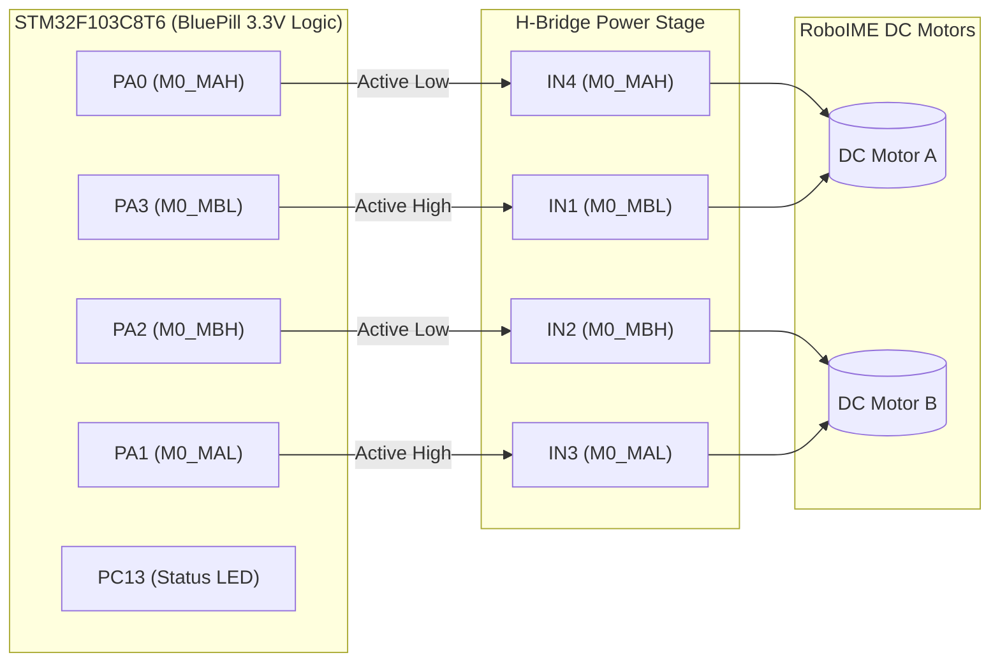

# Dual DC Motor H-Bridge Firmware (STM32 BluePill)

[](https://github.com/VPariz/Teste-Ponte-H/actions/workflows/ci.yml)
[](https://en.wikipedia.org/wiki/C_(programming_language))
[](https://www.st.com/en/microcontrollers-microprocessors/stm32f103c8.html)
[](https://www.st.com/)
[](https://roboime.com.br/)
[](LICENSE)

Embedded C firmware designed and implemented by **João Victor Pariz** for the **RoboIME** autonomous robotics team to validate and control dual DC motor actuation through H-bridge power stages (L298N / discrete MOSFET bridges) using the **STM32F103C8T6 (ARM Cortex-M3 / BluePill)**.

---

## 🎯 System Architecture & Signal Flow



---

## 🎯 Overview & Objectives

* Generate synchronous quadrature switching pulses across STM32 GPIO outputs to validate directional rotation and commutation logic.
* Ensure dead-time separation between high-side and low-side switching to prevent shoot-through currents in power bridges.
* Provide visual status telemetry via the onboard active-low LED (`PC13`) to indicate loop execution and clock stability.

---

## 🔌 Hardware Pinout & Wiring

Connect the STM32 BluePill GPIO pins to the H-bridge logic inputs according to the following layout:

| STM32 Pin (BluePill) | H-Bridge Input | Function | Signal Logic |
| :---: | :---: | :--- | :--- |
| **PA0** | **IN4 / M0_MAH** | Motor B High-Side Drive | Active-Low / Inverted Logic |
| **PA1** | **IN3 / M0_MAL** | Motor B Low-Side Drive | Active-High Logic |
| **PA2** | **IN2 / M0_MBH** | Motor A High-Side Drive | Active-Low / Inverted Logic |
| **PA3** | **IN1 / M0_MBL** | Motor A Low-Side Drive | Active-High Logic |
| **PC13** | Onboard LED | Execution Status Indicator | Active-Low (`0` = ON, `1` = OFF) |
| **GND** | **GND** | Common Reference Ground | **Mandatory** |

> ⚠️ **Grounding Precaution:** Always ensure a shared common ground (`GND`) between the STM32 board and the motor power supply to avoid floating voltage references.

---

## 🛠️ Project Structure

```
Teste-Ponte-H/
├── Core/
│   ├── Inc/
│   │   ├── main.h
│   │   ├── stm32f1xx_hal_conf.h
│   │   └── stm32f1xx_it.h
│   └── Src/
│       ├── main.c              # Application entry point & H-bridge control sequence
│       ├── stm32f1xx_hal_msp.c
│       ├── stm32f1xx_it.c      # Interrupt service routines
│       ├── syscalls.c
│       ├── sysmem.c
│       └── system_stm32f1xx.c  # CMSIS system initialization
├── Drivers/
│   ├── CMSIS/                  # ARM Cortex-M3 CMSIS headers
│   └── STM32F1xx_HAL_Driver/   # STMicroelectronics HAL drivers (GPIO, RCC, etc.)
├── testePonteH.ioc             # STM32CubeMX graphical configuration project
├── .gitignore
└── README.md
```

---

## ⚡ Flashing & Debugging

1. Connect an **ST-Link V2** programmer to the SWD header of the BluePill (`SWDIO`, `SWCLK`, `3.3V`, `GND`).
2. Open **STM32CubeProgrammer** or your preferred toolchain (STM32CubeIDE, OpenOCD, or VS Code with Cortex-Debug).
3. Connect via SWD and flash the compiled binary.
4. Press the hardware `Reset` button to trigger the execution sequence.

---

## 🔄 Execution Logic

The main application loop in [`main.c`](file:///Core/Src/main.c) executes a periodic 4-phase sequence:
1. **Turn ON Indicator:** Asserts `PC13` to visually signal motor activation.
2. **Forward Rotation:** Activates `PA0` / `PA3` for 2000 ms.
3. **Braking & Hold:** Deasserts drivers and turns OFF status LED for 1000 ms.
4. **Reverse Rotation:** Activates `PA2` / `PA1` for 2000 ms.
5. **Full Stop:** Safely deasserts all control lines for 1000 ms before repeating.

---

## 👤 Author & Context

* **João Victor Pariz** ([@VPariz](https://github.com/VPariz)) — Electronics Engineering undergraduate, Instituto Militar de Engenharia (IME).
* Developed within the context of the **RoboIME** Autonomous Systems team to validate hardware driver stages for mobile robotics.

---

## 📜 License
This project is licensed under the [MIT License](LICENSE).
